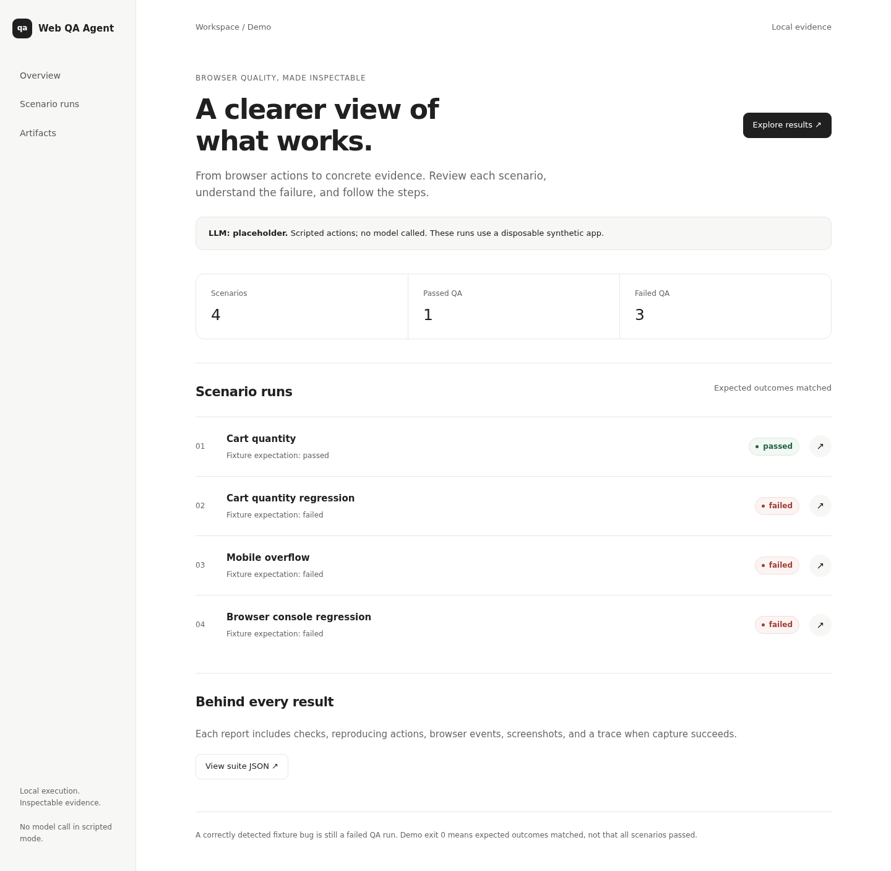
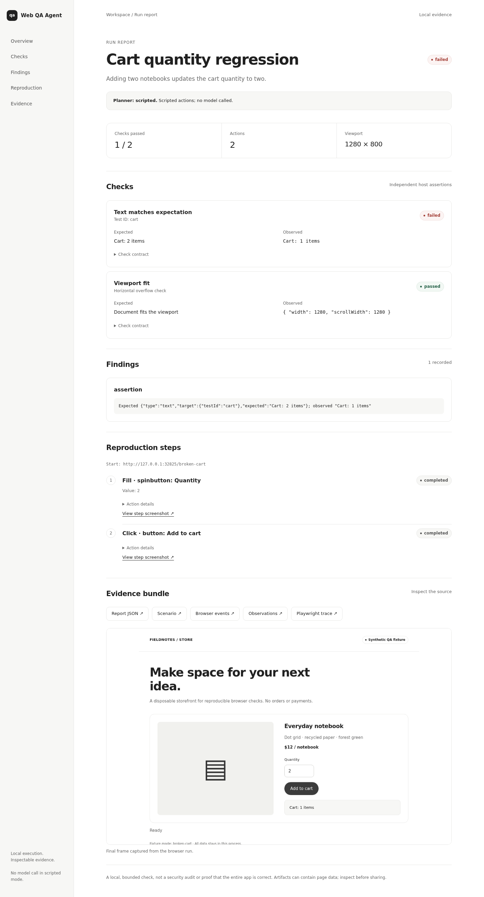

# Web QA Agent

A local-first web QA runner that separates proposed browser actions from the checks that decide whether a flow works.

Give it a disposable local app and a scenario. It executes bounded actions in Chromium, checks the resulting UI, and writes screenshots, browser events, a Playwright trace, and an HTML report. The included fixture contains both working and deliberately broken behavior, so the demo can show a useful failure rather than an unexplained green check.

**Current model status:** API key and model are placeholders. The default demo is scripted, not autonomous AI testing. An optional OpenAI Responses adapter is implemented and tested with mock responses; no live model inference has been validated.

## Run the local demo

Requirements: Node.js 22+, npm, and the Linux/macOS/Windows dependencies required by Playwright Chromium.

```sh
npm ci
npx playwright install chromium
npm test
npm run demo
```

On a Linux machine missing browser libraries, consult [Playwright's installation instructions](https://playwright.dev/docs/browsers#install-system-dependencies). Installing system packages may require administrator approval. Do not bypass managed network or host restrictions.

The demo starts its own loopback server, runs four scenarios, closes the server, and prints the path to an HTML index under `artifacts/demo-*/index.html`. Open that file locally. No account, API key, cloud resource, or running external service is required after dependencies are installed.

| Synthetic case           | Expected QA result | Evidence                                  |
| ------------------------ | ------------------ | ----------------------------------------- |
| Add two notebooks        | passed             | Cart shows two items                      |
| Broken quantity handler  | failed             | Requested two; cart shows one             |
| Fixed-width mobile panel | failed             | Document wider than the 390px viewport    |
| Console regression       | failed             | Visible cart, but a browser console error |

`npm run demo` exits successfully when all four **expected outcomes match**, including the three failed QA runs. It does not mean every page passed.

## Check your own disposable local app

Start the application yourself, then:

```sh
npm run qa -- --target http://127.0.0.1:3000 --scenario scenarios/cart.json
npm run qa -- --target http://127.0.0.1:3000 --scenario scenarios/cart.json --mobile
```

Adapt the example scenario's path, accessible names and checks to your app. Targets must be literal `http://127.0.0.1:PORT` origins. `localhost`, remote hosts, other ports, and authenticated browser profiles are not supported.

An example action is `{"type":"click","target":{"role":"button","name":"Add to cart"}}`. Actions support only `click` and `fill`, using an exact accessible role/name or a test ID. Checks support exact trimmed text, element visibility, and horizontal viewport overflow. Each scenario requires at least one host-owned check.

Scripts are not accepted as actions. The runner's own layout check evaluates a fixed, source-controlled measurement; it never evaluates model-generated JavaScript.

### Verdicts

- `passed`: all configured checks passed, required final evidence was captured, and no captured browser error or policy violation prevented a pass.
- `failed`: an assertion, browser error, or attempted UI action failed.
- `blocked`: a request or proposed action violated the execution policy.
- `incomplete`: the run could not finish reliably, for example due to a timeout, exhausted action budget, unavailable model, evidence failure, or truncated event capture.

CLI exit codes are 0 for passed, 1 for failed, and 2 for blocked, incomplete, or configuration errors. Configuration rejected before browser startup may have no artifact directory.

## Model placeholder and optional adapter

`.env.example` contains only:

```dotenv
OPENAI_API_KEY=YOUR_API_KEY_HERE
OPENAI_MODEL=YOUR_MODEL_ID
```

Leave these placeholders unchanged to stay entirely in the offline scripted workflow. `--planner placeholder` returns `LLM_NOT_CONFIGURED` and never silently falls back to a scripted run.

The optional `--planner openai` adapter uses the [Responses API structured output format](https://developers.openai.com/api/docs/guides/structured-outputs). It proposes one action from a bounded accessibility snapshot. It has no browser handle and cannot edit the scenario's checks. A model's `done` proposal means “run the checks,” not “mark this passed.”

**Future opt-in only:** if you choose to supply your own credentials, create an ignored local `.env`, select a compatible model, and run:

```sh
node --env-file=.env src/cli.mjs run \
  --target http://127.0.0.1:3000 \
  --scenario scenarios/cart.json \
  --planner openai --allow-model-network
```

This uploads the scenario goal, page URL, accessibility observations and recent action proposals to OpenAI and may incur charges. The flag is required even when environment variables are set. Do not use sensitive page content. The request uses `store:false`; that is not a claim of zero provider retention. The demo never enables model networking. Live API compatibility and model planning quality remain unverified.

## Evidence and boundaries

Each run writes `scenario.json`, `report.json`, `report.html`, `events.json`, `observations.json`, and, when capture succeeds, screenshots and `trace.zip`. View a trace locally with:

```sh
npx playwright show-trace artifacts/run-EXAMPLE/trace.zip
```

Artifacts are ignored by Git. They contain unredacted page data and can include personal information, network data or typed values. Inspect them before sharing. Only the synthetic app's report image is committed.

The browser request guard permits same-origin GET/HEAD only. It rejects redirects, cross-origin HTTP requests, writes, WebSockets, popups, downloads, and dialogs. Service workers are blocked. Each run uses a fresh context.

These are **application-level guardrails, not a hostile-browser sandbox**. GET endpoints can mutate state, page JavaScript still runs, and not every possible browser network channel is isolated. Use only an app you control with disposable data, never a real production account. Authentication, write workflows, external CDNs and federated login will generally be blocked.

## What this project explores

- Can a failure report explain the expected state, observed state, and reproducing actions together?
- Can planner mistakes be distinguished from application regressions and policy violations?
- What changes when an agent may suggest actions but cannot decide its own success?
- Which safety restrictions make useful QA flows impossible, and which should be explicit scenario capabilities?

This first milestone is a bounded runner, not a general crawler, visual-diff system, accessibility audit, penetration test, or replacement for a conventional test suite.

See [architecture](docs/architecture.md), [decisions](docs/decisions.md), [test evidence](docs/test-evidence.md), [learning notes](docs/learning-notes.md), and [roadmap](docs/roadmap.md).

## Interface

The demo overview, reports, and synthetic storefront share a restrained, OpenAI-inspired visual direction: neutral surfaces, generous spacing, clear typography, and subtle status accents. This is an independent project, not an OpenAI product.

The overview links to each run. Reports show expected and observed values side by side, with expandable raw contracts and action details. Section navigation, keyboard focus and narrow-screen layouts work without client-side JavaScript or external fonts. The visual refresh does not change QA verdicts or enable model calls.

See [UI design notes](docs/ui-design.md) for boundaries and verification.




